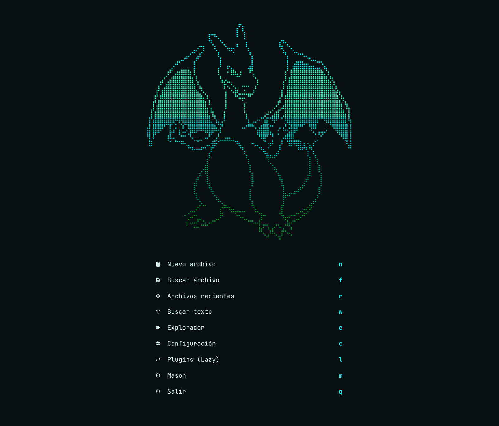
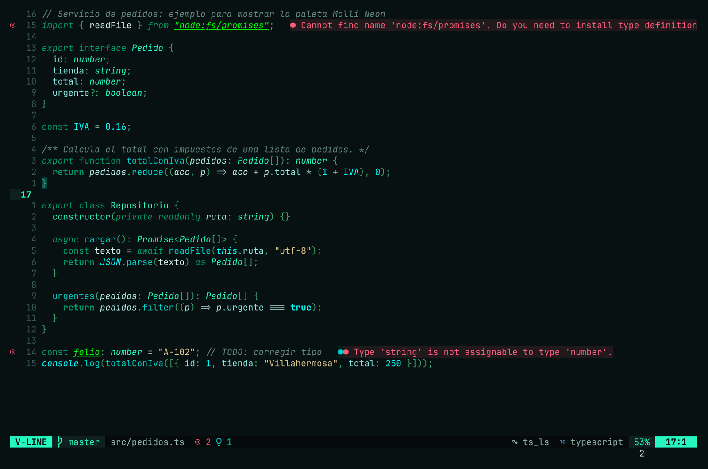
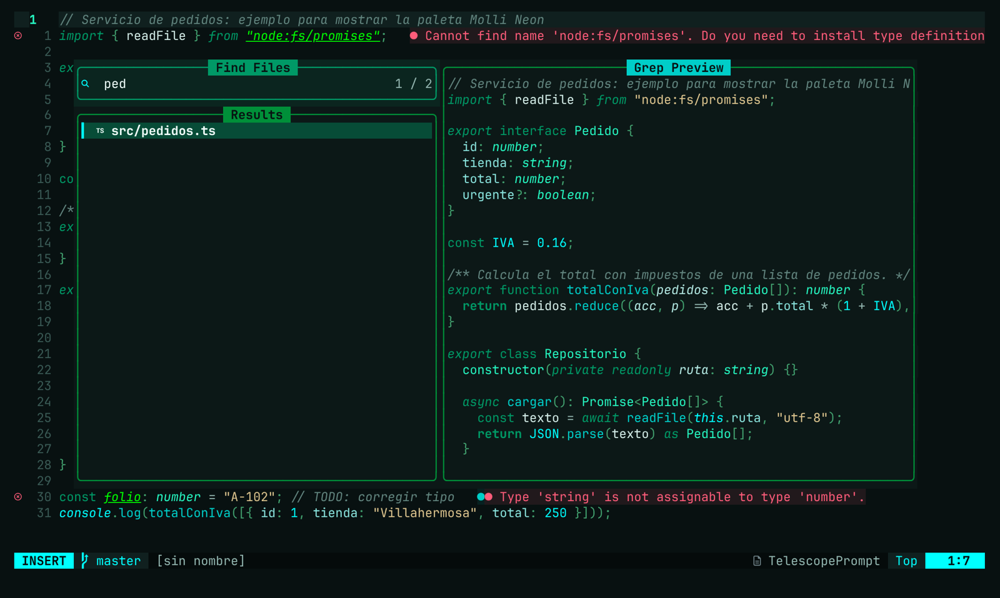
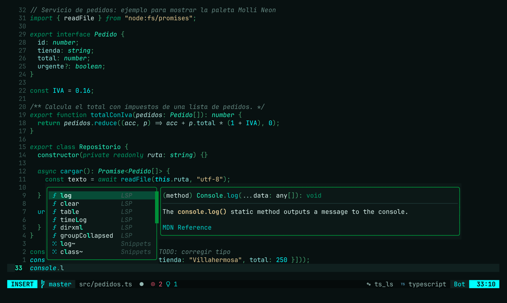

<div align="center">

# nvim-config · Molli Neon

**Configuración de Neovim modular, multiplataforma (Fedora / macOS) .**

Lua · lazy.nvim · LSP nativo de Neovim 0.12 · Mason · blink.cmp · Treesitter




</div>

---

## Contenido

1. [Características](#características)
2. [Capturas](#capturas)
3. [Requisitos](#requisitos)
4. [Instalación en Fedora](#instalación-en-fedora)
5. [Instalación en macOS](#instalación-en-macos)
6. [Verificar que todo funciona](#verificar-que-todo-funciona)
7. [Estructura del proyecto](#estructura-del-proyecto)
8. [Plugins](#plugins)
9. [Lenguajes soportados](#lenguajes-soportados)
10. [Dependencias externas](#dependencias-externas)
11. [Paleta Molli Neon](#paleta-molli-neon)
12. [Atajos de teclado](#atajos-de-teclado)
13. [Depuración (nvim-dap)](#depuración-nvim-dap)
14. [tmux](#tmux)
15. [Mantenimiento](#mantenimiento)
16. [Solución de problemas](#solución-de-problemas)
17. [Cambios respecto a la configuración anterior](#cambios-respecto-a-la-configuración-anterior)

---

## Características

- **Tema propio `molli-neon`** escrito en Lua (sin Gruvbox ni temas de terceros). Todos los colores salen de un solo archivo: `lua/config/colors.lua`.
- **LSP con la API moderna** (`vim.lsp.config` / `vim.lsp.enable`), sin `require("lspconfig").x.setup()`.
- **Mason** instala servidores y formateadores automáticamente, pero **sólo si existen sus requisitos** (npm, python3, go, php, java). Lo que falta se reporta en una notificación en vez de fallar.
- **Formateo sin duplicados**: un solo comando decide si formatea none-ls o el LSP del archivo.
- **blink.cmp** con snippets (friendly-snippets), rutas, buffer, documentación y firma de funciones.
- **nvim-treesitter (rama `main`)** con resaltado, plegado e indentación para 37 parsers.
- **Depuración preparada** (nvim-dap + dap-ui) para Python, Go, C/C++, JS/TS, Java y Dart/Flutter, sin instalar depuradores que no uses.
- **Portátil**: sin rutas absolutas; detección de sistema operativo en `lua/config/platform.lua`.
- Arranque medido: **~35 ms** (los plugins pesados cargan bajo demanda).

## Capturas

| Código con LSP y diagnósticos | Telescope |
| --- | --- |
|  |  |

| Autocompletado (blink.cmp) | Dashboard (Alpha) |
| --- | --- |
|  |  |

> Capturas sugeridas para actualizar el README en el futuro: Neo-tree abierto, una sesión de nvim-dap con la interfaz abierta, un proyecto Flutter con `:FlutterRun`, y `:Mason`.

## Requisitos

| Herramienta | Versión | Para qué |
| --- | --- | --- |
| Neovim | **0.12+** (probado con 0.12.6) | API `vim.lsp.config`, rama `main` de nvim-treesitter |
| Git | cualquiera reciente | lazy.nvim y plugins |
| Compilador C (`gcc`/`clang`) + `make` | — | parsers de Treesitter, telescope-fzf-native |
| `curl`, `tar`, `unzip` | — | Mason y nvim-treesitter |
| `tree-sitter` CLI | **0.26.1+** | compilar parsers (Mason lo instala si falta) |
| ripgrep (`rg`) | — | `<leader>fw` (búsqueda de texto) |
| fd | opcional | búsqueda de archivos más rápida |
| Nerd Font | — | íconos (p. ej. JetBrainsMono Nerd Font) |
| Node.js + npm | LTS | servidores LSP web, Prettier, depurador JS |
| Python 3 | 3.9+ | basedpyright, black, isort, clang-format (vía Mason), jdtls |

Los SDK de cada lenguaje (Go, Rust, Java, PHP, Flutter) sólo son necesarios si trabajas con ese lenguaje.

---

## Instalación en Fedora

### 1. Respaldar la configuración anterior

```bash
mv ~/.config/nvim ~/.config/nvim.bak
# Opcional, para empezar limpio (plugins y paquetes de Mason anteriores):
mv ~/.local/share/nvim ~/.local/share/nvim.bak
mv ~/.local/state/nvim ~/.local/state/nvim.bak
```

### 2. Dependencias base

```bash
sudo dnf install -y neovim git gcc gcc-c++ make curl tar unzip \
  ripgrep fd-find wl-clipboard nodejs npm python3 python3-pip
```

- `fd-find` instala el comando `fd` en Fedora.
- `wl-clipboard` habilita el portapapeles en Wayland (sesión por defecto de Fedora). En X11 usa `xclip`.
- tree-sitter CLI: `sudo dnf install tree-sitter-cli` si tu versión de Fedora lo empaqueta con la 0.26.1 o superior; si no, Mason lo instala automáticamente al primer arranque.

### 3. Herramientas por lenguaje (sólo las que uses)

```bash
# Go (gopls, gofumpt, goimports, sqls y delve se compilan con go install vía Mason)
sudo dnf install -y golang

# Java (jdtls necesita Java 21+ para ejecutarse)
sudo dnf search openjdk          # elige la LTS disponible (21 o 25)
sudo dnf install -y java-21-openjdk-devel   # ajusta el número a lo que muestre la búsqueda

# PHP (php-cs-fixer es un .phar que necesita el intérprete)
sudo dnf install -y php-cli

# Rust (rustup, NO el paquete rust de dnf, para tener rust-analyzer del mismo toolchain)
curl --proto '=https' --tlsv1.2 -sSf https://sh.rustup.rs | sh
rustup component add rust-analyzer rustfmt clippy
```

**Flutter / Dart** (instalación manual, recomendada por Flutter para Linux):

```bash
sudo dnf install -y clang cmake ninja-build pkgconf-pkg-config gtk3-devel xz-devel
mkdir -p ~/development && cd ~/development
# Descarga el .tar.xz estable desde https://docs.flutter.dev/get-started/install/linux
tar xf ~/Descargas/flutter_linux_*-stable.tar.xz
echo 'export PATH="$HOME/development/flutter/bin:$PATH"' >> ~/.bashrc
source ~/.bashrc
flutter doctor
```

### 4. Nerd Font

Descarga *JetBrainsMono Nerd Font* de <https://www.nerdfonts.com/font-downloads>, descomprime en `~/.local/share/fonts/` y ejecuta `fc-cache -fv`. Selecciónala en tu terminal.

### 5. Clonar e iniciar

```bash
git clone https://github.com/th3progr4mmer14/nvim-config.git ~/.config/nvim
nvim
```

En el primer arranque lazy.nvim instala los plugins y Mason instala servidores y formateadores. Cuando terminen, reinicia Neovim.

---

## Instalación en macOS

Probado para Apple Silicon (M1). Los mismos pasos sirven en Intel.

### 1. Respaldar configuración anterior

```bash
mv ~/.config/nvim ~/.config/nvim.bak
mv ~/.local/share/nvim ~/.local/share/nvim.bak 2>/dev/null
mv ~/.local/state/nvim ~/.local/state/nvim.bak 2>/dev/null
```

### 2. Xcode Command Line Tools y Homebrew

```bash
xcode-select --install          # clang, make, git
/bin/bash -c "$(curl -fsSL https://raw.githubusercontent.com/Homebrew/install/HEAD/install.sh)"
```

### 3. Dependencias base

```bash
brew install neovim git ripgrep fd node python
brew install tree-sitter-cli    # si la fórmula no existe en tu Homebrew, Mason lo instala
brew install --cask font-jetbrains-mono-nerd-font
```

El portapapeles funciona sin instalar nada (`pbcopy`/`pbpaste`).

### 4. Herramientas por lenguaje (sólo las que uses)

```bash
# Go
brew install go

# Java 21 (jdtls lo necesita para ejecutarse)
brew install openjdk@21
sudo ln -sfn "$(brew --prefix)/opt/openjdk@21/libexec/openjdk.jdk" /Library/Java/JavaVirtualMachines/openjdk-21.jdk

# PHP
brew install php

# Rust con rustup
curl --proto '=https' --tlsv1.2 -sSf https://sh.rustup.rs | sh
rustup component add rust-analyzer rustfmt clippy

# Flutter (incluye Dart)
brew install --cask flutter
flutter doctor
```

> macOS usa **zsh** por defecto: las líneas `export PATH=...` van en `~/.zshrc`, no en `~/.bashrc`.

### 5. Clonar e iniciar

```bash
git clone https://github.com/th3progr4mmer14/nvim-config.git ~/.config/nvim
nvim
```

---

## Verificar que todo funciona

```bash
# Instalar/sincronizar plugins sin abrir la interfaz
nvim --headless "+Lazy! sync" +qa

# Tiempo de arranque
nvim --startuptime /tmp/nvim-startup.log +qa && tail -1 /tmp/nvim-startup.log
```

Dentro de Neovim:

| Comando | Qué revisa |
| --- | --- |
| `:checkhealth vim.lsp` | Servidores activos y cuáles no tienen ejecutable |
| `:checkhealth nvim-treesitter` | tree-sitter CLI, compilador y parsers |
| `:checkhealth blink.cmp` | Binario del matcher en Rust |
| `:checkhealth mason` | npm, python, go, java, php disponibles |
| `:Mason` | Paquetes instalados / pendientes |
| `:Lazy` | Estado de los plugins |
| `:TSUpdate` | Instala/actualiza parsers |

Prueba rápida por lenguaje: abre un archivo (`nvim prueba.ts`), escribe un error de tipos, verifica el diagnóstico, prueba `K`, `gd`, `<leader>ca` y `<leader>f`. La línea de estado muestra los servidores LSP activos a la derecha.

---

## Estructura del proyecto

```text
nvim-config/
├── init.lua                     # Punto de entrada: globals → options → lazy → tema → keymaps
├── colors/
│   └── molli-neon.lua           # :colorscheme molli-neon
├── lua/
│   ├── config/                  # Núcleo (no son specs de lazy)
│   │   ├── globals.lua          # leader, flags (mason_auto_install, format_on_save…)
│   │   ├── options.lua          # opciones del editor
│   │   ├── keymaps.lua          # atajos generales
│   │   ├── autocmds.lua         # autocomandos generales
│   │   ├── platform.lua         # detección de SO y ejecutables
│   │   ├── lazy.lua             # bootstrap de lazy.nvim
│   │   ├── colors.lua           # ★ PALETA: única fuente de colores
│   │   ├── ascii.lua            # arte del dashboard (original)
│   │   ├── theme/               # motor del tema
│   │   │   ├── init.lua         #   carga y colores de terminal
│   │   │   ├── editor.lua       #   interfaz, menús, diagnósticos
│   │   │   ├── syntax.lua       #   Vim + Treesitter + tokens LSP
│   │   │   ├── plugins.lua      #   Telescope, Neo-tree, Blink, Alpha, Mason, DAP
│   │   │   └── lualine.lua      #   tema de la barra de estado
│   │   ├── lsp/
│   │   │   ├── init.lua         #   diagnósticos + vim.lsp.config/enable
│   │   │   ├── servers.lua      #   ★ servidores y herramientas (qué y de dónde)
│   │   │   ├── capabilities.lua #   capacidades de blink.cmp
│   │   │   ├── keymaps.lua      #   atajos en LspAttach
│   │   │   ├── format.lua       #   quién formatea cada archivo
│   │   │   └── mason_tools.lua  #   instala formateadores con Mason
│   │   └── dap/
│   │       └── adapters.lua     #   adaptadores de depuración por lenguaje
│   └── plugins/                 # Specs de lazy.nvim (una responsabilidad por archivo)
│       ├── lsp/
│       │   ├── mason.lua
│       │   ├── lspconfig.lua    #   nvim-lspconfig + mason-lspconfig
│       │   ├── java.lua         #   nvim-jdtls
│       │   └── flutter.lua      #   flutter-tools.nvim
│       ├── completions.lua      # blink.cmp
│       ├── none-ls.lua          # formateadores
│       ├── treesitter.lua       # parsers + nvim-ts-autotag
│       ├── telescope.lua
│       ├── neotree.lua
│       ├── visuals.lua          # lualine, alpha, devicons
│       ├── tmuxnav.lua
│       └── dap.lua
├── extras/tmux-navigation.conf  # fragmento para ~/.tmux.conf
├── docs/screenshots/
├── .stylua.toml                 # estilo del código Lua de la config (2 espacios)
├── lazy-lock.json               # versiones exactas de plugins (reproducible)
├── LICENSE
└── README.md
```

**¿Por qué `servers.lua` y `capabilities.lua` están en `lua/config/lsp/` y no en `lua/plugins/lsp/`?** lazy.nvim importa *todos* los archivos de `lua/plugins/lsp/` como specs de plugins; un módulo de datos ahí provocaría errores de importación. Separar `config/` (lógica) de `plugins/` (specs) evita ese problema.

---

## Plugins

| Plugin | Función | Carga |
| --- | --- | --- |
| [lazy.nvim](https://github.com/folke/lazy.nvim) | Gestor de plugins | inicio |
| [mason.nvim](https://github.com/mason-org/mason.nvim) | Instala LSP, formateadores y depuradores | inicio |
| [mason-lspconfig.nvim](https://github.com/mason-org/mason-lspconfig.nvim) | Instala los servidores de `servers.lua` | con lspconfig |
| [nvim-lspconfig](https://github.com/neovim/nvim-lspconfig) | Configs base de servidores (`lsp/*.lua`) | al abrir archivo |
| [blink.cmp](https://github.com/saghen/blink.cmp) | Autocompletado | modo inserción / LSP |
| [friendly-snippets](https://github.com/rafamadriz/friendly-snippets) | Colección de snippets | con blink |
| [none-ls.nvim](https://github.com/nvimtools/none-ls.nvim) | Formateadores CLI como LSP | al abrir archivo |
| [nvim-treesitter](https://github.com/nvim-treesitter/nvim-treesitter) (`main`) | Parsers y queries | inicio |
| [nvim-ts-autotag](https://github.com/windwp/nvim-ts-autotag) | Cierre/renombrado de etiquetas | al abrir archivo |
| [telescope.nvim](https://github.com/nvim-telescope/telescope.nvim) | Búsqueda difusa | atajos |
| [telescope-fzf-native.nvim](https://github.com/nvim-telescope/telescope-fzf-native.nvim) | Ordenamiento nativo (si hay `make`) | con Telescope |
| [plenary.nvim](https://github.com/nvim-lua/plenary.nvim) | Librería de utilidades | dependencia |
| [neo-tree.nvim](https://github.com/nvim-neo-tree/neo-tree.nvim) (`v3.x`) | Explorador de archivos | inicio (diferido interno) |
| [nui.nvim](https://github.com/MunifTanjim/nui.nvim) | Componentes UI de Neo-tree | dependencia |
| [nvim-web-devicons](https://github.com/nvim-tree/nvim-web-devicons) | Íconos | dependencia |
| [lualine.nvim](https://github.com/nvim-lualine/lualine.nvim) | Barra de estado | VeryLazy |
| [alpha-nvim](https://github.com/goolord/alpha-nvim) | Dashboard | VimEnter |
| [nvim-tmux-navigation](https://github.com/alexghergh/nvim-tmux-navigation) | Navegar entre Neovim y tmux | sólo dentro de tmux |
| [nvim-jdtls](https://github.com/mfussenegger/nvim-jdtls) | Extras de Java (jdt://, refactors, DAP) | archivos Java |
| [flutter-tools.nvim](https://github.com/nvim-flutter/flutter-tools.nvim) | Flutter: dartls, run, hot reload, DAP | Dart, si existe `flutter` |
| [nvim-dap](https://github.com/mfussenegger/nvim-dap) | Cliente de depuración | atajos de depuración |
| [nvim-dap-ui](https://github.com/rcarriga/nvim-dap-ui) + [nvim-nio](https://github.com/nvim-neotest/nvim-nio) | Interfaz de depuración | con nvim-dap |

El tema **no** es un plugin: vive en `colors/` y `lua/config/theme/`.

---

## Lenguajes soportados

Leyenda de origen: **M** = Mason (automático) · **S** = SDK / gestor del sistema · **R** = rustup.

| Lenguaje | LSP | Formateo | Treesitter | Depuración |
| --- | --- | --- | --- | --- |
| Java | `jdtls` (M, requiere Java 21+ y python3) | jdtls (Eclipse) | `java` | java-debug-adapter + java-test (M) vía nvim-jdtls |
| JavaScript | `ts_ls` (M) + `eslint` (M) | Prettier (M) | `javascript`, `jsdoc` | js-debug-adapter (M) |
| TypeScript | `ts_ls` (M) + `eslint` (M) | Prettier (M) | `typescript`, `tsx` | js-debug-adapter (M) |
| Python | `basedpyright` (M) | isort + Black (M) | `python` | debugpy (M) |
| Dart / Flutter | `dartls` (S, vía flutter-tools) | `dart format` vía dartls | `dart` | incluido en el SDK (flutter-tools) |
| PHP | `intelephense` (M) | php-cs-fixer (M, requiere php) | `php`, `phpdoc` | — |
| C | `clangd` (M) | clang-format (M) | `c` | codelldb (M) |
| C++ | `clangd` (M) — compartido con C | clang-format (M) | `cpp` | codelldb (M) |
| Go | `gopls` (M, requiere go) | goimports + gofumpt (M) | `go`, `gomod`, `gosum`, `gowork` | delve (M) |
| Rust | `rust_analyzer` (R) | rustfmt (R) vía rust-analyzer | `rust` | codelldb (M) |
| Lua | `lua_ls` (M) | StyLua (M) | `lua`, `luadoc` | — |
| HTML | `html` (M) | Prettier | `html` | — |
| CSS | `cssls` (M) | Prettier | `css` | — |
| JSON | `jsonls` (M) | Prettier | `json` | — |
| YAML | `yamlls` (M) | Prettier | `yaml` | — |
| SQL | `sqls` (M, requiere go) | sql-formatter (M) | `sql` | — |
| PostgreSQL | `postgres_lsp` (M) — sólo con `postgres-language-server.jsonc` en el proyecto | sql-formatter (dialecto `postgresql`) | `sql` | — |
| Markdown | `marksman` (M) | Prettier | `markdown`, `markdown_inline` | — |

**Notas**

- `sqls` lee las conexiones a base de datos de un `config.yml` en el proyecto; sin él ofrece funciones limitadas.
- En un proyecto con `postgres-language-server.jsonc` se activan `sqls` y `postgres_lsp` a la vez; si te sobra uno, quítalo de `servers.lua`.
- `eslint` sólo se activa en proyectos con configuración de ESLint y `eslint` instalado en `node_modules`.
- Lombok se activa automáticamente para jdtls (útil en Spring Boot).

---

## Dependencias externas

| Dependencia | Instala | Usada por |
| --- | --- | --- |
| git, curl, tar, unzip | dnf / Xcode CLT + brew | lazy.nvim, Mason, Treesitter |
| gcc/clang + make | dnf / Xcode CLT | Treesitter, telescope-fzf-native |
| tree-sitter CLI ≥ 0.26.1 | dnf / brew / **Mason** | nvim-treesitter |
| ripgrep, fd | dnf (`fd-find`) / brew | Telescope |
| wl-clipboard o xclip | dnf | portapapeles en Linux |
| Node.js + npm | dnf / brew | ts_ls, eslint, html, cssls, jsonls, yamlls, intelephense, prettier, sql-formatter, js-debug-adapter |
| Python 3 | dnf / brew | basedpyright, black, isort, clang-format, debugpy, jdtls |
| Go | dnf / brew | gopls, gofumpt, goimports, sqls, delve |
| Java 21+ | dnf / brew | jdtls |
| PHP | dnf / brew | php-cs-fixer |
| rustup | script oficial | rust-analyzer, rustfmt, clippy |
| Flutter SDK | manual / brew cask | dartls, depurador de Dart |
| Nerd Font | nerdfonts.com / brew cask | íconos |

**Mason instala (en `~/.local/share/nvim/mason`, nunca en el repo):**
lua-language-server, typescript-language-server, vscode-langservers-extracted (html/css/json/eslint), yaml-language-server, basedpyright, intelephense, clangd, gopls, jdtls, marksman, sqls, postgres-language-server, stylua, prettier, black, isort, clang-format, php-cs-fixer, gofumpt, goimports, sql-formatter, tree-sitter-cli. Los depuradores se instalan a mano (ver [Depuración](#depuración-nvim-dap)).

---

## Paleta Molli Neon


### Colores de identidad

| Color | HEX | Rol en la interfaz | Rol en el código |
| --- | --- | --- | --- |
| **Cyan** | `#00FFFF` | cursor, modo INSERT, paréntesis emparejado, atajos del dashboard | números, booleanos, constantes, macros |
| **Emerald** | `#009966` | modo NORMAL, títulos de Telescope/Mason/Lazy, estados OK | palabras clave (`if`, `return`, `class`…) |
| **Forest Green** | `#008F39` | bordes de ventanas flotantes, expansores de Neo-tree, Git *added* | (mezclado) puntuación y llaves |
| **Turquoise** | `#00CEC8` | carpetas, título de vista previa, *hints*, modo COMMAND | funciones, métodos, atributos |
| **Neon Mint** | `#26F7C1` | número de línea actual, coincidencias de búsqueda, modo VISUAL, info | tipos, clases, interfaces, escapes |

### Tonos derivados (fondos y texto)

| Rol | HEX | Uso |
| --- | --- | --- |
| `bg_deep` | `#050B0B` | Neo-tree, barra de estado |
| `bg` | `#081111` | fondo del editor (negro verdoso) |
| `bg_float` | `#0C1817` | flotantes, menús, Telescope |
| `surface` | `#10201F` | cursorline |
| `fg` | `#D3ECE7` | texto principal |
| `fg_dim` | `#93B6B0` | texto secundario, operadores |
| `comment` | `#62857F` | comentarios (cursiva) |
| `sand` | `#DCC48E` | cadenas: un acento cálido para que no todo sea verde/cian |
| `error` / `warn` | `#FF5C7A` / `#F5BE4F` | errores y advertencias, claramente distintos de la marca |

Selección, búsqueda, selección de menús y fondos de diagnósticos se **derivan** mezclando un color de marca con el fondo (`colors.blend`), así que los neón nunca se usan como superficies grandes.

### Contraste (WCAG, sobre `#081111`)

| Elemento | Ratio | | Elemento | Ratio |
| --- | --- | --- | --- | --- |
| Texto principal | 15.4 | | Funciones (turquesa) | 9.7 |
| Constantes (cian) | 15.2 | | Puntuación | 6.0 |
| Tipos (menta neón) | 13.8 | | Errores | 6.4 |
| Cadenas | 11.2 | | Palabras clave (esmeralda) | 5.2 |
| Advertencias | 11.3 | | Comentarios | 4.7 |

Todo el texto de código supera 4.5:1 (nivel AA). Los números de línea inactivos (2.5:1) son decorativos a propósito.

### Cambiar un color

1. Edita `lua/config/colors.lua` (sección `brand`, `base` o `roles`).
2. Ejecuta `:colorscheme molli-neon` — se recarga todo, incluida lualine.

Para cambiar *qué* se pinta con cada color, modifica la tabla `roles` (p. ej. `keyword = b.turquoise`); los archivos de `theme/` nunca usan HEX directos.

---

## Atajos de teclado

Leader = `Espacio`. `<leader>f` comparte prefijo con `<leader>ff/fw/fm`, así que espera `timeoutlen` (500 ms) antes de formatear; `<leader>cf` formatea al instante.

### Generales

| Atajo | Acción |
| --- | --- |
| `<leader>e` | Abrir/cerrar Neo-tree (en la ventana actual) |
| `<leader>E` | Mostrar el archivo actual en Neo-tree |
| `Ctrl+h/j/k/l` | Moverse entre ventanas (y paneles de tmux dentro de tmux) |
| `Ctrl+flechas` | Redimensionar ventana |
| `Shift+h` / `Shift+l` | Buffer anterior / siguiente |
| `Esc` | Quitar resaltado de búsqueda |
| `J` / `K` (visual) | Mover selección abajo / arriba |
| `Esc Esc` (terminal) | Salir del modo terminal |
| `<leader>tf` | Alternar formateo al guardar |
| `<leader>tw` | Alternar ajuste de línea |
| `<leader>th` | Alternar inlay hints |
| `<leader>cm` | Abrir Mason |

### Búsqueda (Telescope)

| Atajo | Acción |
| --- | --- |
| `<leader>ff` | Buscar archivos |
| `<leader>fw` | Buscar texto (ripgrep) |
| `<leader>fm` | Buscar buffers |
| `<leader>fM` | Buscar marcas |
| `<leader>fr` | Archivos recientes |
| `<leader>fh` | Ayuda |
| `<leader>fd` | Diagnósticos |
| `<leader>fk` | Atajos |
| `<leader>fc` | Palabra bajo el cursor |
| `<leader>f/` | Buscar en el buffer |
| `<leader>fn` | Archivos de esta configuración |
| `<leader>fR` | Retomar última búsqueda |
| `Ctrl+j/k` (en Telescope) | Siguiente / anterior resultado |

### LSP (sólo en buffers con servidor)

| Atajo | Acción |
| --- | --- |
| `gd` | Ir a definición |
| `gD` | Ir a declaración |
| `gr` | Referencias (Telescope) |
| `gI` | Implementaciones |
| `gy` | Definición de tipo |
| `K` | Documentación |
| `<leader>ca` | Code action (normal y visual) |
| `<leader>rn` | Renombrar |
| `<leader>f` / `<leader>cf` | Formatear |
| `<leader>d` | Diagnóstico de la línea |
| `[d` / `]d` | Diagnóstico anterior / siguiente (nativos) |
| `<leader>q` | Diagnósticos a la lista local |
| `<leader>ls` / `<leader>lS` | Símbolos del documento / workspace |
| `<leader>li` | `:checkhealth vim.lsp` |
| `<leader>lr` | Reiniciar servidores (`:lsp restart`) |

Los atajos nativos `grr`, `gra`, `grn`, `gri`, `grt`, `grx` de Neovim 0.11+ se eliminan para que `gr` responda sin espera; sus funciones están en la tabla de arriba.

### Autocompletado (blink.cmp, preset `super-tab`)

| Atajo | Acción |
| --- | --- |
| `Tab` / `Shift+Tab` | Aceptar / saltar en snippet |
| `Ctrl+n` / `Ctrl+p` o `↑` / `↓` | Navegar |
| `Ctrl+Space` | Abrir menú / alternar documentación |
| `Ctrl+e` | Cerrar menú |
| `Ctrl+b` / `Ctrl+f` | Desplazar documentación |
| `Ctrl+k` | Alternar ayuda de firma |

### Java (`nvim-jdtls`)

`<leader>jo` organizar imports · `<leader>jv` extraer variable · `<leader>jc` extraer constante · `<leader>jm` (visual) extraer método · `<leader>jt` depurar test cercano · `<leader>jT` depurar clase de test.

### Flutter (`flutter-tools`)

`<leader>Fr` run · `<leader>Fl` hot reload · `<leader>FR` hot restart · `<leader>Fq` quit · `<leader>Fd` dispositivos · `<leader>Fe` emuladores · `<leader>Fo` outline · `<leader>Fg` log.

### Depuración

| Atajo | Acción |
| --- | --- |
| `F5` | Iniciar / continuar |
| `F10` / `F11` / `F12` | Saltar / entrar / salir |
| `<leader>b` / `<leader>B` | Breakpoint / breakpoint condicional |
| `<leader>xu` | Alternar interfaz |
| `<leader>xe` | Evaluar expresión |
| `<leader>xr` | REPL |
| `<leader>xl` | Repetir última sesión |
| `<leader>xC` | Ejecutar hasta el cursor |
| `<leader>xt` | Terminar |

En macOS las teclas F requieren `fn` o activar *Usar F1, F2, etc. como teclas de función estándar*.

---

## Depuración (nvim-dap)

Los depuradores **no se instalan solos**: cada uno depende de un SDK que quizá no tengas. Instala sólo los que uses y reinicia Neovim; el adaptador se registra si su ejecutable existe.

| Lenguaje | Instalar | Requisito |
| --- | --- | --- |
| Python | `:MasonInstall debugpy` | python3 (usa `.venv`/`venv` o `$VIRTUAL_ENV` del proyecto) |
| Go | `:MasonInstall delve` | Go |
| C / C++ / Rust | `:MasonInstall codelldb` | compila con `-g` (`gcc -g`, `cargo build`) |
| JS / TS | `:MasonInstall js-debug-adapter` | Node.js; para TS ejecuta el JS compilado o usa Node ≥ 22.6 con *type stripping* |
| Java | `:MasonInstall java-debug-adapter java-test` | jdtls funcionando; después `:DapNew` detecta las clases `main` |
| Dart / Flutter | — (incluido en el SDK) | flutter-tools lo registra (`debugger.enabled = true`) |

Para agregar otro lenguaje, añade su adaptador en `lua/config/dap/adapters.lua` siguiendo el mismo patrón (`if has("ejecutable") then …`).

---

## tmux

`nvim-tmux-navigation` sólo se carga cuando Neovim corre dentro de tmux. Para que `Ctrl+h/j/k/l` también cruce entre paneles de tmux, agrega a `~/.tmux.conf` el contenido de [`extras/tmux-navigation.conf`](extras/tmux-navigation.conf) y ejecuta `tmux source ~/.tmux.conf`.

Para colores reales dentro de tmux añade también:

```tmux
set -g default-terminal "tmux-256color"
set -as terminal-features ",*:RGB"
```

---

## Mantenimiento

### Actualizar plugins

```vim
:Lazy update      " actualiza y reescribe lazy-lock.json
:Lazy restore     " vuelve a las versiones de lazy-lock.json
:MasonUpdate      " actualiza el registro de Mason
:Mason            " U = actualizar todos los paquetes
:TSUpdate         " actualiza parsers (obligatorio tras actualizar nvim-treesitter)
```

Confirma `lazy-lock.json` en git después de actualizar: así ambos equipos (Fedora y Mac) usan las mismas versiones.

### Agregar un servidor LSP

1. Busca el nombre en la lista de nvim-lspconfig (`:help lspconfig-all` o el directorio `lsp/` del repositorio).
2. Agrégalo a `M.servers` en `lua/config/lsp/servers.lua`:

   ```lua
   tailwindcss = { mason = true, requires = "npm" },
   ```

   - `mason = false` si lo instalas fuera de Mason.
   - `config = { settings = { … } }` para opciones propias.
3. Reinicia Neovim: Mason lo instala y `vim.lsp.enable` lo activa.

### Agregar un lenguaje nuevo

1. **Parser**: añádelo a `parsers` en `lua/plugins/treesitter.lua` (nombres en `:help nvim-treesitter` / `SUPPORTED_LANGUAGES.md`).
2. **LSP**: añádelo a `servers.lua` (paso anterior).
3. **Formateador**: si el LSP no formatea, agrega el builtin de none-ls en `lua/plugins/none-ls.lua` y su paquete a `M.tools` en `servers.lua`.
4. **Depurador** (opcional): adaptador en `lua/config/dap/adapters.lua`.
5. **Colores**: no hace falta nada; Treesitter usa los grupos `@…` del tema.

### Ajustes locales por máquina

Crea `lua/config/local.lua` (está en `.gitignore`) para opciones o atajos que sólo quieras en un equipo. Se carga al final del arranque.

Los flags de `globals.lua` se pueden cambiar sin editar el repo:

```bash
nvim --cmd "let g:mason_auto_install = v:false"
```

---

## Solución de problemas

| Síntoma | Causa / solución |
| --- | --- |
| Íconos como cuadros o signos `?` | Falta Nerd Font en la terminal, o pon `vim.g.have_nerd_font = false` en `globals.lua`. |
| "Falta tree-sitter CLI" | Espera a que Mason instale `tree-sitter-cli` y ejecuta `:TSUpdate`, o instálalo con dnf/brew/cargo. |
| No hay resaltado en un lenguaje | `:checkhealth nvim-treesitter`; revisa compilador C y `:TSUpdate`. |
| "Servidores LSP omitidos por requisitos faltantes" | Instala lo indicado (npm, go, java, php…) y reinicia. |
| Un servidor no arranca | `:checkhealth vim.lsp` muestra si falta el ejecutable; el log está en `:lua vim.cmd.edit(vim.lsp.log.get_filename())`. |
| `rust_analyzer quit with exit code 1` | `rustup component add rust-analyzer`. |
| jdtls no inicia | `java -version` debe ser 21+; luego `:MasonInstall jdtls` y reinicia. Borra la caché con `:JdtWipeDataAndRestart`. |
| Dart sin LSP | `flutter` (o `dart`) debe estar en el PATH del shell que abre Neovim; `flutter doctor`. |
| El portapapeles no funciona en Fedora | `sudo dnf install wl-clipboard` (Wayland) o `xclip` (X11). |
| `<leader>f` tarda medio segundo | Es el prefijo compartido con `<leader>ff`; usa `<leader>cf`. |
| Formatea con la herramienta equivocada | Revisa `lua/config/lsp/format.lua`: si none-ls tiene formateador para el filetype, gana none-ls. |
| Lua se formatea con tabuladores | Tu proyecto tiene un `stylua.toml`/`.editorconfig` que lo pide; sin él se usan 2 espacios. |
| Colores apagados dentro de tmux | Ver sección [tmux](#tmux) (`RGB`). |
| blink.cmp advierte del matcher en Rust | `:BlinkCmp download!`; si no hay binario para tu plataforma usa el matcher en Lua automáticamente. |
| Restos de la config anterior (pyright, jedi) en Mason | `:MasonUninstall pyright jedi-language-server`. Ya no se activan, pero ocupan espacio. |

---

## Cambios respecto a la configuración anterior

Se auditó la configuración original (`init.lua` + 8 módulos) y se conservó todo lo útil. Cambios y su motivo:

| Antes | Ahora | Motivo |
| --- | --- | --- |
| `gruvbox.nvim` | Tema propio `molli-neon` | Requisito: identidad visual propia y controlable desde un archivo. |
| `vim.bo.undofile = true` | `vim.opt.undofile = true` | `vim.bo` sólo afectaba al primer buffer; el undo persistente no funcionaba en el resto. |
| `ca` / `cd` (modo normal) | `<leader>ca` / `<leader>d` | Pisaban el operador `c`: `caw`, `cap`, `ca(`… quedaban esperando o dejaban de funcionar. |
| `<leader>gf` formatear | `<leader>f` y `<leader>cf` | Atajo pedido; un solo formateador por archivo. |
| `<leader>fm` = marcas | `<leader>fm` = buffers, marcas en `<leader>fM` | Atajo pedido; se conserva la búsqueda de marcas. |
| `pyright` + `jedi_language_server` | `basedpyright` | Corrían los dos: diagnósticos y completado duplicados. |
| `capabilities` sin definir en lsp-config | Capacidades de blink.cmp | La variable era `nil` (global inexistente), los servidores no recibían las capacidades del completado. |
| `"BurntSushi/ripgrep"` como plugin | `rg` binario del sistema | Clonar el código de ripgrep no instala el binario. |
| `tab = "0.1.5"` en Telescope | `version = "*"` | `tab` no es una opción de lazy (se ignoraba). |
| `eslint_d` (none-ls-extras) | servidor `eslint` | Mismos diagnósticos + code actions, sin daemon; none-ls-extras deja de ser necesario. |
| Treesitter sin instalar parsers | 37 parsers + plegado + indentación | La rama `main` no instala nada por sí sola. |
| `vim.diagnostic.config` dentro de la spec | `lua/config/lsp/init.lua` | Estaba dentro de la tabla del plugin, ejecutándose al importar el archivo. |
| Botones por defecto de Alpha | Botones con los atajos reales | Anunciaban atajos (p. ej. `SPC f h`) que no existían. |
| tmux-navigation siempre | Sólo dentro de tmux | Evita choque con los atajos `Ctrl+h/j/k/l` fuera de tmux. |

Se conservaron: indentación de 2 espacios, búsqueda `ignorecase`/`smartcase`, `scrolloff = 8`, splits abajo/derecha, números absolutos + relativos, `signcolumn`, `wrap = false`, portapapeles del sistema, leader en espacio, preset `super-tab` de Blink con documentación automática, Neo-tree en la ventana actual con expansores, lualine sin separadores, nvim-ts-autotag con sus opciones, `disable_when_zoomed` y todos los atajos de tmux-navigation, y el arte ASCII del dashboard.

---

## Publicar en GitHub

```bash
cd ~/.config/nvim
git init -b main
git add .
git commit -m "feat: configuración inicial de Neovim con tema Molli Neon"

# Con GitHub CLI:
gh repo create th3progr4mmer14/nvim-config --public --source . --push --description "Neovim 0.12 · Lua · tema Molli Neon"

# O manualmente (crea el repo vacío en github.com primero):
git remote add origin git@github.com:th3progr4mmer14/nvim-config.git
git push -u origin main
```

Sugerencias para el repositorio: temas `neovim`, `neovim-config`, `lua`, `dotfiles`, `colorscheme`; sube las capturas de `docs/screenshots/`.

---

## Licencia

[MIT](LICENSE) © 2026 Eduardo Suarez Mollinedo (Molli)
